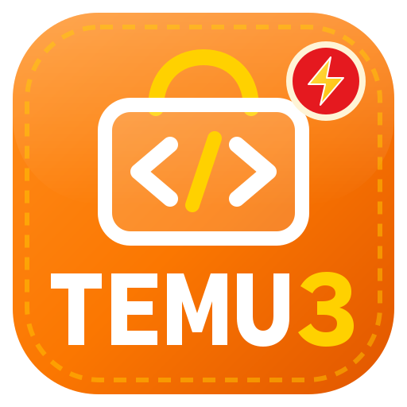
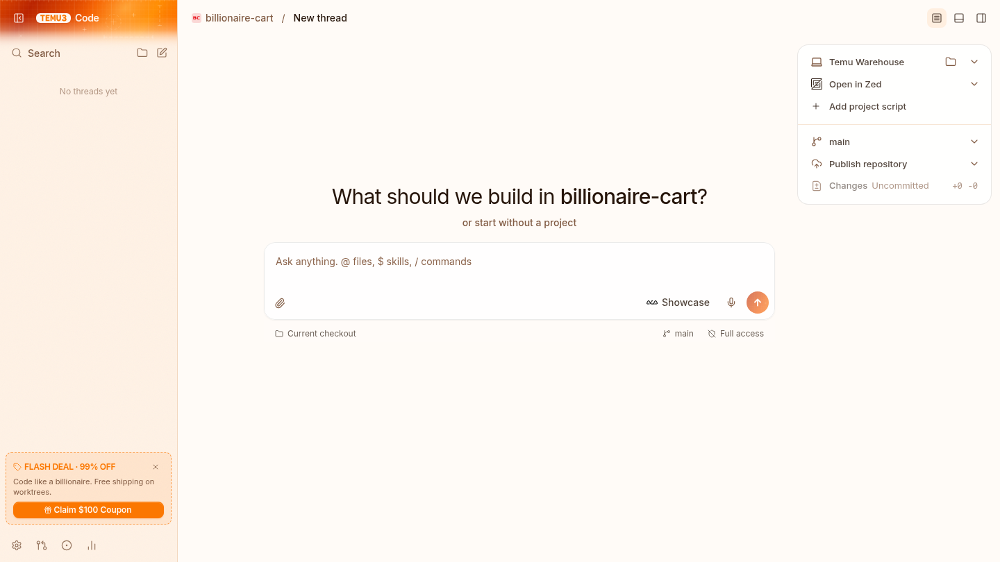
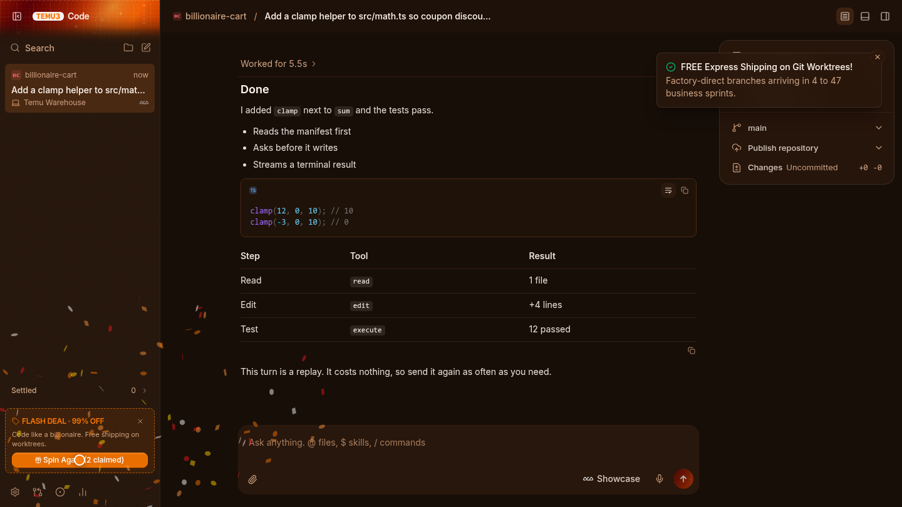
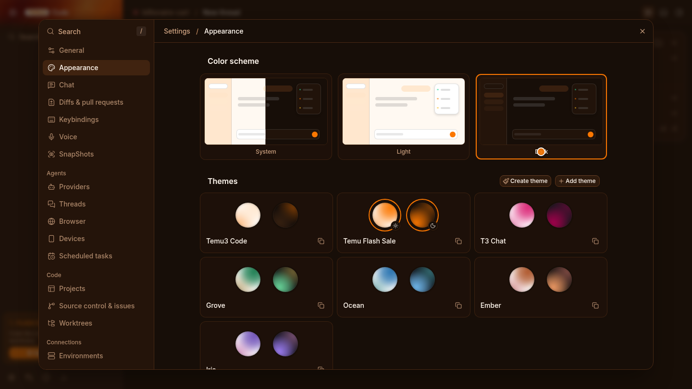

<p align="center">
  
</p>

<h1 align="center">Temu3 Code</h1>

<p align="center">
  <strong>Shop like a billionaire. Ship like a 10x dev.</strong><br />
  The factory-direct, open-source <strong>ADE (Agentic Development Environment)</strong> at <strong>99.97% OFF*</strong>.
</p>

<p align="center">
  <code>⚡ LIGHTNING DEAL ENDS IN 00:09:59 · FREE SHIPPING ON GIT WORKTREES · ONLY 2 CONTEXT WINDOWS LEFT IN STOCK ⚡</code>
</p>

---

> **Parody Notice:** **Temu3 Code** is an unofficial meme fork created purely as a joke and is **not** shipped, endorsed by, or affiliated with T3 Tools, Inc. or Temu. No actual $100 token coupons exist, no coworkers need to be invited to unlock `git push`, and your API bill is still very real.

---

**Temu3 Code** is an Agentic Development Environment (ADE) that runs the coding agents on your machine and wraps them in one suspiciously fast, aggressively orange marketplace interface. Add a feature request to your cart at your desk, then impulse-approve the next bash command from your phone at 2:14 AM like a $1.49 USB-powered noodle fan.

It works out of the box with **Claude Code**, **Codex**, **Cursor**, **OpenCode**, **Grok Build**, **Antigravity**, **Kiro**, **Pi**, **Muse Code**, **fx**, and any [ACP](./docs/user/providers-acp.md) agent. If an agent is installed on your computer, Temu3 Code will slap a **FLASH DEAL** sticker on it and put it to work.

## What's in Your Cart (ADE Features)

- **Factory-Direct Subscriptions ($0.00 Markup, $100.00 Fake Coupons):** Temu3 Code does not resell tokens. It drives the agents you are already signed in to — _plus_ you can click **Claim $100 Coupon** in the sidebar as many times as you want for a free burst of orange confetti and $0.00 in savings.
- **Spin the Model Wheel Mid-Thread:** Start an architectural refactor with Claude, hit a lightning deal, and hand the exact same thread to Codex for final checkout.
- **Impulse-Approve From Anywhere (Desktop, Web & Phone):** One local server, every screen synced. Start a build on your desktop, review diffs on the web, and approve tool calls from the couch.
- **FREE Express Shipping on Git Worktrees:** Every thread gets its own isolated git worktree shipped straight from the factory floor. Inspect the diff, commit, push, and open a pull request with one glorious orange button.
- **Built-In Temu Marketplace Theme (Light & Dark):** Ships pre-dressed in authentic **Temu Tangerine (`#FB7701`)**, **Coupon Wheel Gold (`#FFD100`)**, and **Flash-Sale Crimson (`#E5191F`)** — including both the default **Temu3 Code** theme and the extra-spicy **Temu Flash Sale** preset in **Settings → Appearance**.
- **Remote Ready:** Run agents on any machine over your local network, Tailscale, or tunnel — no customs duties required.
- **Suspiciously Fast:** Even as a joke fork, performance is still taken seriously. No GPU-melting infinite animations, just crisp sub-millisecond impulse shipping.

## Verified Buyer Reviews (4.98 / 5 ⭐ — 100,000+ Sold*)

| Rating     | Verified Developer       | Review                                                                                                                                                                              |
| ---------- | ------------------------ | ----------------------------------------------------------------------------------------------------------------------------------------------------------------------------------- |
| ⭐⭐⭐⭐⭐ | `10x_bargain_hunter`     | _"Ordered a 3-line CSS tweak during a flash sale. Arrived in 14 seconds as a full TypeScript refactor with unit tests. Packaging was extremely orange. Would impulse-merge again."_ |
| ⭐⭐⭐⭐⭐ | `cart_full_of_worktrees` | _"Spun the sidebar coupon wheel 6 times and unlocked FREE Express Shipping on Git Worktrees. Still paid my own API bill, somehow still felt like a billionaire."_                   |
| ⭐⭐⭐⭐☆  | `async_checkout_enjoyer` | _"Approved a migration from my phone at 1:47 AM while buying a miniature rice cooker. Both arrived before standup."_                                                                |

<sub>*0 actually sold. This is a meme branch.</sub>

## Demo Recording & Screenshots

> Watch the live 1440×810 recording of **Temu3 Code** running end-to-end (claiming the `$100` coupon with confetti, toggling **Temu Flash Sale** Light & Dark themes in Settings, and running a live streaming agent turn with tool calls & tests): [`docs/demo/temu3-code-demo.mp4`](./docs/demo/temu3-code-demo.mp4).

<p align="center">
  
  
</p>
<p align="center">
  
</p>

## Build & Run From Source

Temu3 Code is built with [Vite+](https://viteplus.dev/guide/) (`vp`) and pnpm:

```bash
# Install workspace dependencies
vp i

# Build server, web, desktop, and marketing apps
vp run build

# Start the local dev server + Temu3 Code web UI (uses isolated dev state)
vp run dev
```

Open the pairing URL printed by the dev runner to enter the **Temu3 Code** marketplace. You can test streaming agent turns for free using the built-in `Replay (dev)` provider without spending a single real token.

## "Wait, what are you actually selling me?"

Literally nothing. Not even a silicone avocado slicer.

We forked an open-source ADE, painted it bright Temu orange, renamed every single reference to **Temu3 Code**, bolted a confetti-shooting fake coupon button into the sidebar, and verified the whole thing builds and runs end-to-end — purely for the bit.

## License & Trademarks

The underlying source code in this repository is licensed under the [MIT License](./LICENSE).

**Temu3 Code** is an unofficial parody fork created solely as a meme. It is not affiliated with, sponsored by, or endorsed by T3 Tools, Inc. or PDD Holdings / Temu. See [TRADEMARK.md](./TRADEMARK.md) for the upstream trademark policy.
